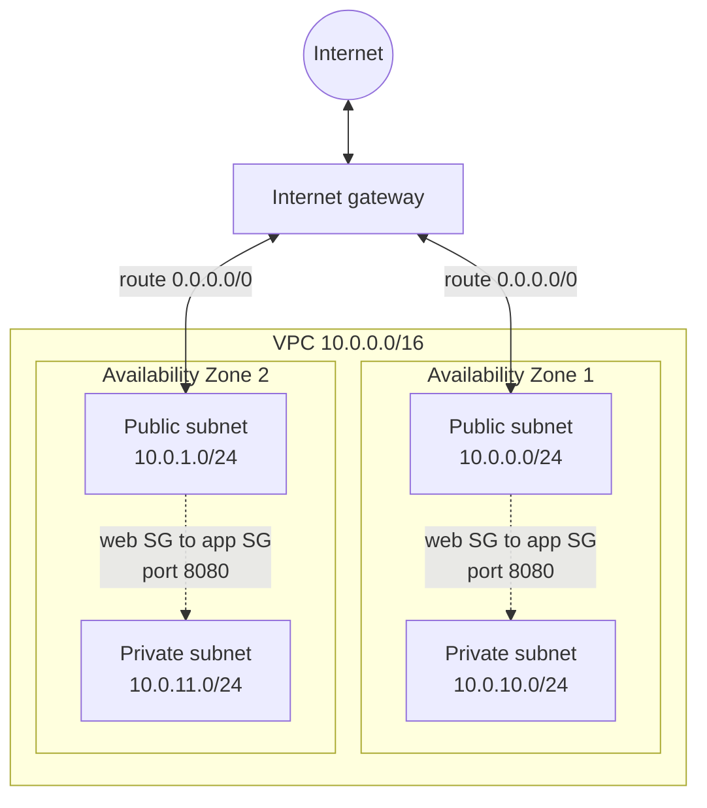
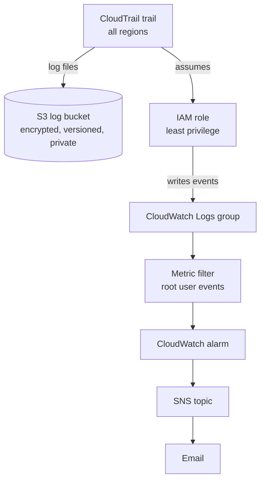

# AWS Secure Baseline

A small Terraform project that builds the security groundwork an AWS account should have before any workload goes into it: a segmented network, an audit trail, locked-down log storage, a least-privilege role, and an alarm on root user activity.

I deployed it, tested it and destroyed it in my own AWS account on November 17, 2026.

## What it demonstrates

- **Infrastructure as code.** All 32 resources are defined in Terraform and can be created and removed with one command each.
- **Network segmentation.** A VPC with public and private subnets across two Availability Zones. Only the public subnets have a route to the internet.
- **Least-privilege IAM.** One role that only CloudTrail can assume, limited to two actions on one log group.
- **Secure storage.** An S3 bucket with all public access blocked, encryption at rest, versioning and TLS-only access.
- **Audit logging.** A multi-region CloudTrail trail with log file validation.
- **Detection.** A CloudWatch alarm that fires when the root user is used, tested end to end.
- **Cost awareness.** Nothing with an hourly charge. No NAT gateway and no compute.

## Architecture

### Network



The private subnets have no route out of the VPC. The security groups are a pattern for a future workload; nothing is attached to them yet.

### Audit and alerting



## What gets built

| File | Resources | Purpose |
|---|---|---|
| `network.tf` | VPC, internet gateway, 2 public and 2 private subnets, 2 route tables, 4 associations | The network. A subnet is public only because its route table points at the internet gateway. |
| `security_groups.tf` | Default security group (no rules), web and app security groups, 4 rules | Firewalls. HTTPS in to the web tier; the app tier accepts traffic only from the web tier. No SSH. |
| `s3.tf` | Bucket, public access block, encryption, versioning, bucket policy | Private, encrypted storage for audit logs that only this trail can write to. |
| `iam.tf` | Role and its inline policy | Lets CloudTrail create log streams and put log events in one log group, and nothing else. |
| `cloudtrail.tf` | CloudWatch Logs group, CloudTrail trail | Records API activity in every region to S3 and to CloudWatch Logs. |
| `monitoring.tf` | Metric filter, alarm, SNS topic, optional email subscription | Counts root user events and raises an alarm when there is one or more. |

Supporting files: `versions.tf` (version pins), `providers.tf` (region and default tags), `variables.tf`, `locals.tf`, `outputs.tf`.

## Prerequisites

- An AWS account and a non-root identity with permission to create the resources above
- [Terraform](https://developer.hashicorp.com/terraform/install) 1.10 or later
- [AWS CLI](https://docs.aws.amazon.com/cli/latest/userguide/getting-started-install.html) v2, signed in

I used an IAM user with MFA and `aws login`, which gives the command line short-lived credentials through the browser. No access keys were created or stored.

## Deploy

```bash
git clone https://github.com/Needest26/aws-secure-baseline.git
cd aws-secure-baseline

aws login            # or any other way of providing AWS credentials
terraform init       # download the AWS provider
terraform plan       # preview: 31 resources, or 32 with an alert email
terraform apply      # type "yes" to build
```

To get an email when the alarm fires, copy `terraform.tfvars.example` to `terraform.tfvars` and set `alert_email`. AWS sends a confirmation email that has to be accepted first. `terraform.tfvars` is ignored by Git.

## Destroy

```bash
terraform destroy    # type "yes" to remove everything
```

The log bucket is created with `force_destroy = true` so that this works even when it contains logs. For anything long-lived, set `force_destroy_log_bucket = false`.

## Verified

Run in `us-east-1` with Terraform 1.17.2 and AWS provider 6.73.0.

```text
Apply complete! Resources: 32 added, 0 changed, 0 destroyed.
Destroy complete! Resources: 32 destroyed.
```

Checked with the AWS CLI while it was running:

| Check | Result |
|---|---|
| Trail | Logging, multi-region, global service events on, log file validation on |
| Log bucket | All four public access blocks on, AES-256 encryption, versioning enabled, not public |
| Default security group | 0 rules |
| Route tables | Public has `0.0.0.0/0` to the internet gateway; private has only the local route |

Alarm test:

| Time (UTC) | Event |
|---|---|
| 04:18 to 04:19 | Three failed root console sign-in attempts, each logged by CloudTrail |
| 04:22 | Alarm changed from OK to ALARM (3 root events counted against a threshold of 1) |
| Shortly after | Alert email received through SNS |

## Cost

Designed to cost nothing, or very close to it:

- VPC, subnets, route tables, internet gateway, security groups and IAM have no charge.
- The first CloudTrail trail delivering management events is free.
- One alarm, one custom metric and a few kilobytes of logs fall within the CloudWatch always-free allowances.
- S3 storage for a short test is a fraction of a cent.

There is no NAT gateway, load balancer or instance, so nothing bills by the hour. I had it running for about half an hour. Pricing changes, so check the AWS pricing pages and run `terraform destroy` when you are done.

## Not included, on purpose

- **NAT gateway.** It has an hourly charge. The private subnets therefore have no outbound internet access.
- **Compute.** No instances or load balancers; the security groups are ready for them.
- **Remote state.** State is local and ignored by Git. A team would use an S3 backend with locking.
- **Customer-managed KMS key.** The bucket uses S3-managed encryption keys.
- **VPC flow logs.**

## What I learned

- A subnet is public when it is connected to an internet gateway through its route table, and private when it is not.
- An IAM role dictates permissions: it gives access to specific services and specific actions. Least privilege means giving exactly the access required to do the job, and no more.
- `terraform plan` only shows what would happen. Nothing is built until I type `yes` to `terraform apply`.
- I signed in to the command line as the root user by mistake. I fixed it by logging root out, turning on MFA, and signing in as an IAM user instead.
- My own failed root sign-in attempts set off the alarm I had just built, and the alert email arrived a few minutes later. That showed me the whole chain works.
- The hardest part was putting everything together and getting the code to run.

## Author

Needest Djidonou · [LinkedIn](https://www.linkedin.com/in/needestdjidonou-it)
